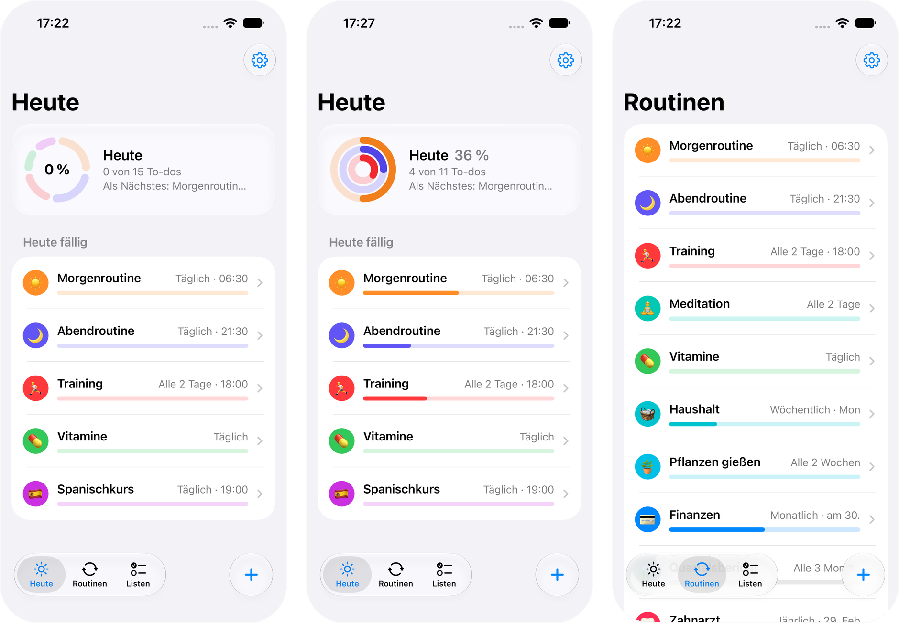
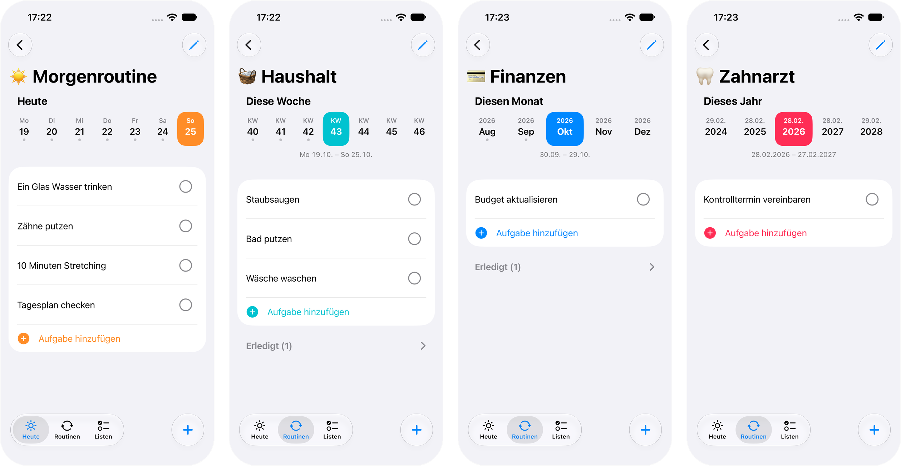
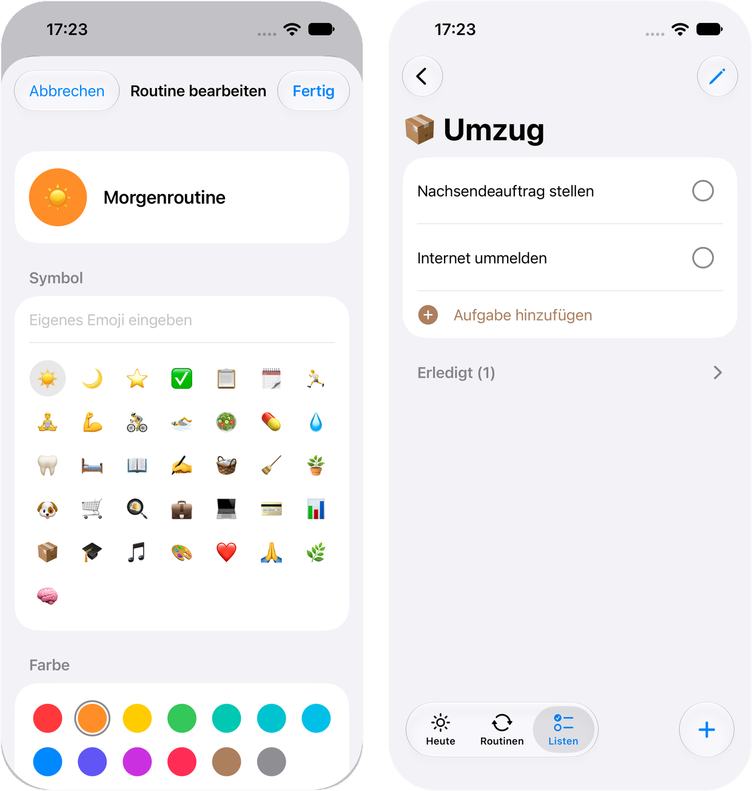

# Routines

**A to-do app for the things you do again and again – and that remembers what you did.**

Routines is a native SwiftUI app for iPhone, iPad and Mac. It's built around recurring lists: morning and evening routines, weekly chores, monthly admin, yearly check-ups – plus simple one-off lists like a packing list.

> 🧪 **Status:** Routines is in active development and is currently being tested on the simulator and on my own iPhone. It's not available on the App Store yet.



*The Today screen with two of the selectable ring styles, and the overview of all routines.*

---

## Why I built this

I have a lot of routines in my life, and none of the to-do apps I tried really handled them well. Usually a recurring task either just resets itself (and whatever you did yesterday is gone), or a checked-off task disappears until it's due again. What I actually wanted to see was:

- what's left **today** or **this week** – at a glance,
- what I **got done last week** (and what I didn't),
- what's **coming up**, so I can plan one-off tasks for a future day or week right away.

So I started building the app I wanted to use myself.

## What makes it different

**Nothing ever resets.** Every list is split into periods – a day, a week, a month, a year, or "every n" of those. Each check-off is stored for its period, so history is kept, and a new period simply starts fresh on its own.

**Browse through time.** Inside a list, a strip under the title lets you swipe through past and future periods:

- look back and check off things you forgot to tick,
- look ahead and plan one-off tasks for a future day, week, month or year,
- coloured dots show at a glance which periods were complete, incomplete or have something planned.



*The period strip for a daily (one calendar week), weekly, monthly and yearly list.*

**Flexible recurrence.** Daily, weekly, monthly or yearly, each also as "every n days/weeks/months/years". Weekly lists reset on a weekday of your choice, monthly lists keep their anchor day (a list that starts on the 31st resets on the last day of shorter months), and every list can have an optional start time.

**Make it yours.** Routines is meant to be personalised:

- every list gets its own **emoji** and **colour** from a curated palette (Apple colours plus five hand-picked colour groups),
- choose the **ring style** for your daily progress card and pick **which routines count** towards it,
- set the app's **accent colour** and switch between **light, dark or system** appearance,
- choose whether completed one-off lists **clean themselves up** automatically after a while.



*Picking an emoji and colour for a routine, and a one-off moving list in its own colour.*

**Built to feel native.** Liquid Glass navigation, inline editing like in Reminders (tap a title to edit, press return to add the next task), drag-and-drop reordering and swipe-to-delete with "only this time / all future" options.

## Planned features

- ☁️ iCloud sync across iPhone, iPad and Mac
- 🔔 Notifications and a Live Activity when a routine starts
- 📱 Home Screen widgets with the progress ring
- 📊 Statistics and streaks (the history is already being stored)
- 🗂 A task tracker with status columns, categories, due dates and progress
- 🗑 "Recently deleted" for lists and tasks
- 🖥 A redesigned iPad and Mac layout
- ⌚️ Apple Watch app, Siri and Shortcuts support

## How this app is built

**Disclaimer: Routines is a vibe-coded app.** Most of the code is written by [Claude](https://claude.ai) (Anthropic's AI assistant), not typed by me line by line.

My focus is on **system design and feature development**: I decide what the app should do and how it should behave, design the data model and the recurrence logic, make the product and UX decisions, and test everything on real devices. My workflow looks like this:

1. **Plan** – every feature is first described and discussed in [`Docs/PROJECT.md`](Docs/PROJECT.md), the living spec for the project (architecture, rules, decisions and conventions).
2. **Design** – for UI changes, I compare several mockup variants before choosing one.
3. **Generate** – Claude writes the code according to the spec and the project's conventions.
4. **Build & test** – I build the app in Xcode, test it on the simulator and on my iPhone, and run the unit tests.
5. **Iterate** – I report bugs and change requests, review the result and commit.

## Privacy

All data stays on your device. There are no accounts, no analytics and no servers. Once iCloud sync is added, your data will only be synced through your own iCloud account.

## Tech stack

- **SwiftUI** and **SwiftData**, no third-party dependencies
- **Swift Testing** for unit tests
- iOS, iPadOS and macOS 26 or later, built with Xcode 27
- All core logic (data model, recurrence engine, progress ring rules) lives in a local Swift package, **RoutineKit**, separate from the UI. This keeps it testable and reusable for widgets, the Watch app or a Live Activity later.

### Project structure

```
Docs/
  PROJECT.md            Spec, architecture and conventions – read this first
  Images/               Screenshots used in this README
Routines/
  Routines.xcodeproj    Xcode project
  Routines/             App target (SwiftUI views)
  RoutineKit/           Local Swift package: models, recurrence engine, services, theme, tests
```

### Running it locally

- Open `Routines/Routines.xcodeproj` in Xcode.
- **Tests:** select the scheme "RoutineKit", destination "My Mac", then press ⌘U.
- **Simulator with sample data:** select the scheme "Routines (Testdaten)" (launch argument `-sampleData`).

## License

© 2026 Laura Siedenhans. All rights reserved.

This repository is public so you can look at the code and follow the project. It is not open source: you may not copy, modify, distribute or use the code or the design, in whole or in part, without my written permission.
